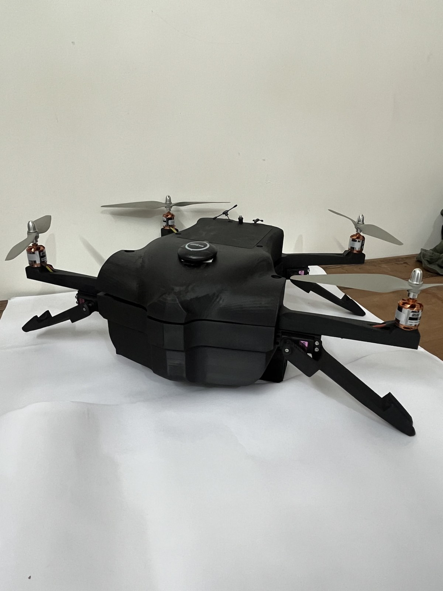
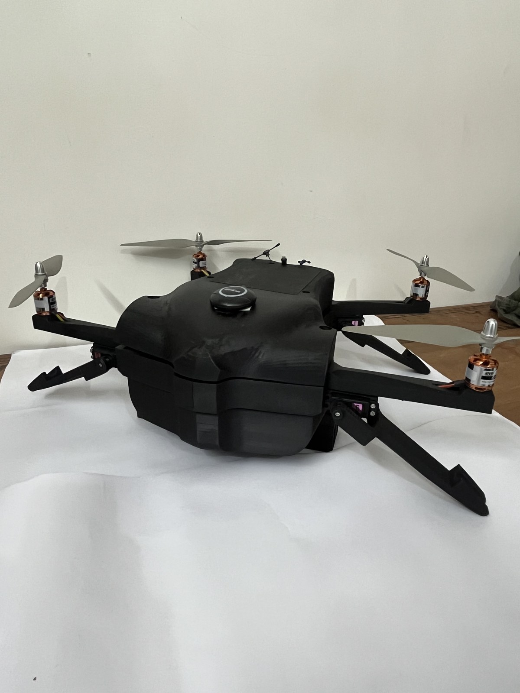

# Logistics Delivery Drone Prototype

A team-built multirotor prototype for carrying and releasing small logistics payloads. The drone used a **Pixhawk 6C Mini running PX4**, incorporated a **servo-operated payload release**, and carried **300 g for approximately 12 minutes** during testing.

## My contribution

I worked on **building the drone** and **helped design the servo-operated payload release mechanism** as part of the team.

- **Drone building:** Contributed to the physical construction of the drone prototype.
- **Payload mechanism design:** Assisted with designing the mechanism for carrying and releasing the payload using a servo.

My work combined hands-on drone construction with mechanical design support for the payload system.

## Design overview

The prototype combines a multirotor airframe, a Pixhawk 6C Mini flight controller running PX4, and a servo-operated release mechanism. The mechanism holds the payload and uses servo movement to release it.

Integrating the payload mechanism required considering the additional load alongside the drone’s structure and propulsion system. The prototype’s overall weight became an important constraint during flight testing.

## Hardware and test results

| Item | Details |
| --- | --- |
| Flight controller | Pixhawk 6C Mini |
| Firmware | PX4 |
| Payload mechanism | Servo-operated release |
| Payload carried | 300 g |
| Approximate flight time with payload | 12 minutes |
| Main limitation | Achievable altitude was limited by overall drone weight |
| My work | Drone building and assistance with payload mechanism design |

The prototype carried a 300 g payload and achieved approximately 12 minutes of flight. Its overall weight limited the altitude it could achieve during testing. These figures describe the prototype’s observed performance rather than a maximum rated payload or endurance specification.

## Engineering lesson

The main lesson from the prototype was the importance of managing the complete vehicle weight, including the airframe, battery and payload mechanism. A payload system must be considered as part of the whole aircraft when evaluating flight performance.

For a future iteration, reducing structural and mechanism weight and assessing the available thrust against the total take-off weight would be priorities. These are proposed improvements, not changes already tested.

## Prototype photographs

